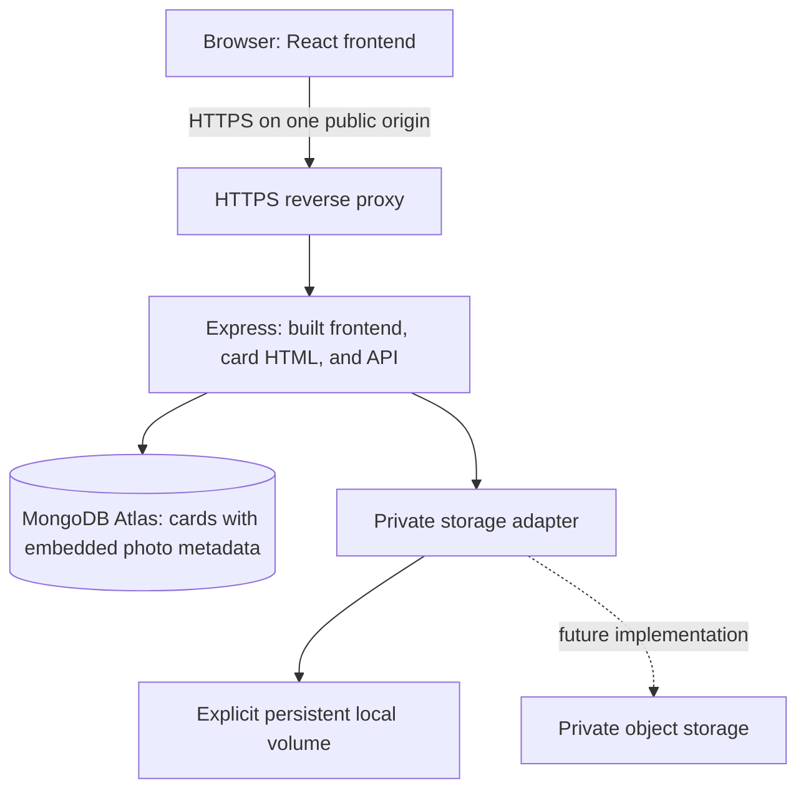

# Deploying Emotale

Little messages. Lasting feelings.

The Emotale name does not require renaming the `Card_codex` directory, the
existing `card_codex` database, or private storage paths. Keep current credentials
and data locations when deploying the branding update. Example origins such as
`https://emotale.example` are placeholders, not a provisioned domain.

The guarded MySQL import tooling, its `mysql2` dependency, original SQL schema,
and migration safety tests remain part of the migration/rollback workflow below.
The running application connects only to MongoDB. Local verification artifacts
removed during branding were obsolete screenshots, an old health-only script,
and a downloaded archive; existing database directories and private files remain.

Phase 9 prepares the application for a small **single-process** deployment.
MongoDB Atlas is the production database target. No Atlas account, cluster, or
hosting provider has been provisioned or tested here.

## Architecture



React requests relative `/api/...` URLs. The browser, card links, API, and
social preview image must use the **same public HTTPS origin**, for example
`https://emotale.example`. Each `schema_version: 1` card contains its content,
customization, protection fields, status, timestamps, nullable expiry, and zero
to four `media` entries. Each entry contains its public media ID, private storage
key, MIME type, byte size, dimensions, order, and creation time. The adapter
stores image bytes; Express authorizes access before reading them.

One insert saves the card and all its metadata atomically. The application
creates no separate `card_media` collection and uses no multi-document
transaction for normal saves. Unique binary indexes protect share tokens,
media IDs, storage keys, and imported SQL IDs; validation also prevents duplicate
photo IDs, keys, or order inside a card. There are no TTL indexes: expiry blocks
new reads using the database clock and preserves the record and private bytes.

## 1. Prepare Atlas and private storage

Create an Atlas cluster and add only your deployment's outbound IP addresses
to its network access list. Use distinct setup, runtime, and migration identities.
The setup identity needs collection/validator/index administration privileges;
the runtime needs scoped reads and writes to its application database. Importers
need a read-only source identity and scoped access to the prepared staging target,
not permission to alter source data. Never share a connection URI or put it in
frontend configuration.

The native MongoDB driver uses primary reads, retryable writes, majority
acknowledgement, and verified TLS in production. Certificate/hostname bypasses,
TLS disabling, secondary reads, and weakened write acknowledgement are rejected
in production configuration. A local MongoDB server can exercise embedded saves
without transaction support; production Atlas access must still be verified on
the actual host.

Choose a private persistent volume for the currently implemented local adapter.
The default application/container disk is **not reliable production storage**.
Mount the durable volume, restrict its OS permissions to the service account,
and arrange backup/restore. On Windows, configure NTFS ACLs; POSIX mode bits
alone do not establish Windows privacy. The directory must be outside frontend
public/build directories and must not be a symlink or junction.

Production refuses implicit development storage unless you explicitly set
`ALLOW_LOCAL_STORAGE_IN_PRODUCTION=true` and supply an absolute private volume
path. This opt-in is an interim deployment choice, not an object-storage
implementation or a guarantee against disk loss. You can defer deployment
until an object adapter is implemented; no cloud provider is forced now.

## 2. Configure the runtime

Use `server/.env.production.example` as a checklist. Supply secrets through
your hosting platform's secret manager or an uncommitted `server/.env`.
Hosting environment variables take priority over that file. Keep development
configuration separate; do not overwrite the current `.env` blindly.

| Variable | Production setting |
| --- | --- |
| `NODE_ENV` | `production`; enables CSP, built frontend, and Secure cookies |
| `PUBLIC_APP_ORIGIN` | Actual HTTPS origin without path, credentials, query, or fragment |
| `HOST`, `PORT` | Bind address and port; default `127.0.0.1:3001`; containers may need `0.0.0.0` |
| `TRUST_PROXY` | Exact controlled proxy IP/CIDR list, such as `127.0.0.1/32`; default `false` |
| `MONGODB_URI` | Atlas connection URI; secret and server-only |
| `MONGODB_DB_NAME` | Explicit database name; letters, numbers, or underscores |
| `MONGODB_MAX_POOL_SIZE` | Per-server pooled connection cap and active-operation limit, default 5, range 1–100 |
| `MONGODB_MIN_POOL_SIZE` | Minimum connections, default 0, range 0–50 |
| `MONGODB_CONNECT_TIMEOUT_MS` | TCP connection deadline, default 3000 ms |
| `MONGODB_SERVER_SELECTION_TIMEOUT_MS` | Server discovery deadline, default 3000 ms |
| `MONGODB_WAIT_QUEUE_TIMEOUT_MS` | Maximum pending/driver checkout wait, default 1000 ms, range 100–30000 |
| `MONGODB_QUEUE_LIMIT` | Maximum pending application operations, default 10, range 0–100 |
| `MONGODB_OPERATION_TIMEOUT_MS` | Total operation budget including queueing, connection, selection and execution, default 3000 ms, range 500–30000 |
| `MONGODB_MAX_IDLE_TIME_MS` | Pooled idle connection lifetime, default 60000 ms, range 1000–600000 |
| `MEDIA_DRIVER` | `local` until another adapter is implemented |
| `MEDIA_DIRECTORY` | Absolute path on the provisioned private persistent volume |
| `ALLOW_LOCAL_STORAGE_IN_PRODUCTION` | Explicit `true` only after preparing and accepting local storage |

Do not put database/storage credentials in `client/.env`, browser JavaScript,
the public directory, Docker image layers, build output, or committed files.
There is no browser API-base setting in this architecture. `API_PROXY_TARGET`
(optional override) and `PUBLIC_APP_ORIGIN` are read from `server/.env`
by Vite on the server side for local development/preview. The proxy target
defaults to `HOST` and `PORT`; an all-interface bind uses loopback as its target.
Vite does not load `client/.env`, and no database settings are injected into the
browser. An existing private `client/.env` is preserved but inactive; move any
intentional public-origin/proxy override to `server/.env` before restarting.
Production Express reads the same `PUBLIC_APP_ORIGIN`. Both `.example` files
are reference templates only, never loaded automatically. The short development
template omits optional tuning and the guarded import/test settings below;
those capabilities and their disabled-by-default safeguards are unchanged.

The driver pool limit applies per server and excludes monitoring connections.
The application admission layer separately bounds active work and queue length;
a checkout timeout alone would not cap the number of pending requests. The
shared connection bridge explicitly connects before operations, coalesces
concurrent connection attempts, and permits recovery after a failed attempt.

## 3. Build and migrate

From the project root, with Node.js 24 or later and npm:

```powershell
npm ci --include=optional
npm test
npm run build
npm audit --omit=dev
```

Build with development dependencies available: Vite/Tailwind are build tools.
Keep `client/dist`, the server, `shared`, package manifests, and the lockfile
in the deployment artifact. Sharp needs the optional native package for the
target operating system; install dependencies for that system rather than
copying Windows `node_modules` onto a Linux host.

Run the idempotent setup command before starting the server. Temporarily set
`MONGODB_URI` to a setup user with permission to create collections, apply
validators, and create indexes:

```powershell
npm run db:migrate
```

`npm run db:migrate` installs the embedded `cards` validator, required unique
indexes, and checksummed setup records in `schema_migrations`. It serializes
concurrent jobs using a bounded, renewed lease. It is repeatable for a compatible
database; changed applied checksums, conflicting indexes/collation, TTL indexes,
incompatible card documents, or existing referenced photo data stop setup for
review. It never converts or deletes existing cards/photos or drops conflicting
indexes. The original SQL migrations remain unchanged.

`npm run db:check` verifies the connection and effective validators/indexes.
Switch to the restricted runtime identity after setup and run
that check again. The runtime checks schema readiness before code hashing,
photo preparation, and native inserts; it does not implicitly create missing
application collections or run setup during requests.

### Import into a separate staging database

Inventory existing MySQL and MongoDB data before choosing a source. Back up
the source, target, schema history, and private photo volume. Use a separate
staging database for each source cohort; importers refuse unrelated target
records and do not merge differing source datasets automatically. Set the
target `MONGODB_URI` privately and `MONGODB_DB_NAME` explicitly. An apply target
must end in `_staging` or `_test`. Prepare its schema with the setup command
before applying; a dry-run does not create collections, indexes, validators,
or import checkpoints.

MySQL source settings are `MYSQL_SOURCE_HOST`, optional `MYSQL_SOURCE_PORT`
(default 3306), `MYSQL_SOURCE_USER`, `MYSQL_SOURCE_PASSWORD` (an explicitly
supplied empty value is accepted), and `MYSQL_SOURCE_DB_NAME`. Use
`MYSQL_SOURCE_SSL=true` for remote production sources; it enables both
certificate and hostname verification. Optional `MYSQL_SOURCE_SSL_CA_FILE`
supplies a trusted PEM CA file; blank uses the trusted system CAs.

```powershell
# Read-only source/target inspection; also the default without a flag.
npm run db:import:mysql -- --dry-run
```

Applying additionally requires all these explicit acknowledgements:

| MySQL apply setting | Required value |
| --- | --- |
| `ALLOW_MYSQL_IMPORT` | `true` |
| `MYSQL_SOURCE_WRITE_FROZEN` | `true` after stopping source writes |
| `MYSQL_IMPORT_BACKUPS_CONFIRMED` | `true` after verifying backups |
| `MONGODB_IMPORT_TARGET_STAGING` | `true` for the designated staging target |
| `MONGODB_IMPORT_TARGET_EMPTY` | `true` for the initial import into empty card/photo data; a matching saved checkpoint permits resume |

```powershell
# Only after reviewing dry-run, backups, frozen writes, and prepared staging.
npm run db:import:mysql -- --apply
```

The MySQL reader uses a read-only consistent snapshot, UTC session/timestamp
handling, string unsigned BIGINT IDs, and keyset pagination. It parses serialized
JSON once, preserving strings, scalars, arrays, objects, and nulls. Existing
tokens, hashes, hints, customization, raw status, dates, photo keys/IDs/dimensions,
byte sizes, and order are retained. SQL IDs are private decimal strings on the
card/media documents. Private raw-status snapshots preserve MySQL's original
collated `status = 'active'` result only while the stored status still matches
its imported snapshot; a later status change uses the normal exact comparison.
Original source migration history is retained inside the import checkpoint
and in the source backup, separate from application schema version records.

For the existing referenced MongoDB prototype, supply `SOURCE_MONGODB_URI`
and `SOURCE_MONGODB_DB_NAME` privately alongside the target settings. Source
and target database names must differ, even if their URI aliases differ.

```powershell
npm run db:import:referenced -- --dry-run
```

Its apply requires `ALLOW_REFERENCED_IMPORT=true`,
`SOURCE_MONGODB_WRITE_FROZEN=true`, `MONGODB_IMPORT_BACKUPS_CONFIRMED=true`,
`MONGODB_IMPORT_TARGET_STAGING=true`, and the same initial
`MONGODB_IMPORT_TARGET_EMPTY=true` acknowledgement, plus a prepared `_staging`
or `_test` target:

```powershell
npm run db:import:referenced -- --apply
```

This conversion retains each card's ObjectId, existing public token/media IDs,
hashes, content, timestamps, and file keys. Former media and parent ObjectIds
are preserved as private metadata, with a private import marker permitting
legacy JSON/hash compatibility. Absent optional title, recipient name, or
customization fields receive the existing compatible `null` defaults; required
protection/content/status/date fields must be valid. Private import markers/IDs,
SQL status snapshots, hashes, and storage keys never enter public responses.
Neither importer copies or
deletes photo bytes or writes source records.

Both importers validate complete cards with all metadata before inserting them.
An existing exactly matching source record is skipped; changed data, token/ID/key
conflicts, unsupported values, more than four photos, JSON number precision loss,
or timestamps requiring sub-millisecond rounding stop with counts and a safe
error. BSON documents over 16 MiB and JSON text/keys that cannot round-trip
also stop for review. There are no overwrites or silent truncation. Checkpoints advance only
after an acknowledged complete batch; an interrupted ordered batch can be
resumed by verifying already inserted records and inserting the remainder.

Keep source writes frozen through field/count/file/API verification and cutover.
Point the runtime at the verified target only after checking protected/unprotected
reads, expiry, case-sensitive tokens, photo authorization, and health. Preserve
the source, private files, original SQL/history backups, and `mysql2` through the
rollback acceptance period. If target-only cards are created after cutover,
account for them before rollback; do not discard those writes by blindly
reverting configuration. Disable importer acknowledgements in normal runtime.

### Explicit disposable-database verification

`npm run test:db` requires `ALLOW_MONGODB_INTEGRATION_TEST=true`,
`MONGODB_TEST_URI`, and a separate `MONGODB_TEST_DB_NAME` ending `_test`. It
uses those test settings only, never a fallback to runtime credentials. Prepare
that test database's schema separately before running the API verifier.

```powershell
# After supplying test-only credentials and preparing that database's schema.
npm run test:db
```

The API verifier uses random ownership markers, tokens, observed document IDs,
and temporary private storage, then removes only its own records/files. The
gated `server/tests/mongodb-integration.test.js` uses newly named collections
within the explicit test database for real validator/index checks; cleanup
deletes its recorded IDs and schema records. Neither tool drops a database or
uses a production photo directory. Tests without the explicit opt-in skip the
real MongoDB suite. Import/check/test errors omit credentials, raw driver errors,
messages, hashes, and private addresses/paths.

Portable checks and local disposable MongoDB verification do not establish
Atlas connectivity, a completed source import, or production deployment.
Those steps still require the actual deployment's private settings and backups.

## 4. Start Express behind HTTPS

After building, setting up indexes, and switching to restricted runtime credentials:

```powershell
npm start
```

Use a process supervisor with automatic restarts. Do not use Vite development
or `vite preview` as the public production server. Express serves `/`,
`/health`, `/card/:shareToken`, hashed assets, the generic preview PNG, and `/api`.
Direct card navigation and refresh therefore preserve server-rendered social
metadata before React loads. An invalid/expired card returns friendly 404
HTML, and dependency failure returns safe 503 metadata.

Terminate public TLS at your reverse proxy/hosting ingress. Forward all these
paths to Express on the private backend port, preserve the configured public
origin, and overwrite client-supplied forwarded headers. Only the proxy should
reach that port in production. Configure `TRUST_PROXY` to match its actual
addresses; `true`, hop counts, and all-address CIDRs are rejected. Incorrect
proxy trust can combine everyone into one rate-limit identity or permit spoofing.
See [Express's proxy guidance](https://expressjs.com/en/guide/behind-proxies/).

The proxy must permit at least 21 MiB request bodies for four 5 MiB photos plus
form details. For example, a 22 MiB edge limit accommodates this; the app still
enforces four files, 5 MiB each, and 64 KiB of card details. Set upload deadlines
consistent with the app's 120-second request deadline, and protect the service
with suitable edge connection/traffic limits. Test the actual target host.
Never serve `server/storage`, the private volume, `.env`, or server source as
static web content. The app also rejects public/build storage roots and links.

## 5. Browser and security behavior

Production accepts credentialed browser API requests only from the exact
configured origin. It never uses `Access-Control-Allow-Origin: *` with
credentials. Untrusted/null browser origins receive 403; supported preflights
allow only GET/HEAD/POST and Content-Type. Crawlers and operational requests
without an Origin header remain supported. Separate frontend/API domains are
not configured: proxy `/api` and card HTML through the same public origin.

CSP permits scripts and API calls from self, local/blob/data images, and the
inline styles required by React card appearance. Inline scripts/eval are not
enabled. Other headers prevent framing and MIME sniffing, suppress referrers,
disable unused device permissions, and retain native Web Share. HTTPS has
180-day HSTS without subdomain/preload commitments. Local Vite development
omits production CSP so its refresh script and WebSocket still work.
See [MDN's style CSP reference](https://developer.mozilla.org/en-US/docs/Web/HTTP/Reference/Headers/Content-Security-Policy/style-src).

Unlock grants remain random, HttpOnly, Secure in production, SameSite=Strict,
scoped to the card's API path, and expire after 30 minutes. Salts/scrypt
parameters, failed-unlock limits, and private-media authorization are preserved.
Public social metadata stays generic even after unlocking; it includes no
names, messages, hints, codes, hashes, or private photos. Use a public HTTPS
URL to verify actual social-platform previews after deployment.

| Limit per client IP | Default |
| --- | --- |
| All card creation | 60 per 15 minutes, before body parsing |
| Protected creation / photo uploads | 20 per 15 minutes each |
| Failed unlocks | 5 per card and 20 across cards per 15 minutes |
| Card reads / preview API / card HTML | 240 per minute combined |
| Media reads | 600 per 5 minutes |
| Health probes | 60 per minute |

These counters and access grants are in memory. Run one Node process initially;
restart clears them, and recipients can unlock again. Multiple replicas require
shared grant and rate-limit stores first. The default limit store does not
synchronize instances, as explained in the
[rate-limit store documentation](https://express-rate-limit.mintlify.app/reference/stores).

## 6. Health, logs, shutdown, and recovery

- `/api/health/live`: 200 when the process can answer, independent of dependencies.
- `/api/health/ready`: 200 when the database/required schema and storage are
  available, otherwise 503. Use this for routing readiness.
- `/api/health`: compatible connection report with a storage status row at `/health`.

Dependency probes coalesce and cache for five seconds; each has a 3.5-second
deadline. Storage verifies a private write/read/remove probe and leaves no
probe files. Health bodies expose statuses, not addresses, paths, credentials,
SQL, or stack traces. Configure monitors to stay within the probe limits.

Operational JSON logs contain known events, mode, port, dependency status,
or a failing configuration variable's **name**. They omit request bodies/URLs,
cookies, codes, hashes, messages, credentials, and raw exceptions. Startup
configuration failures exit safely; dependency failures leave liveness running
and readiness degraded. `build_missing` means run `npm run build`;
`port_in_use` means adjust/stop the conflicting listener.

SIGINT/SIGTERM stop new requests, drain active responses, and then close the
database admission layer: queued requests are rejected, running operations
settle, and the shared client closes. A 10-second deadline forces termination
if cleanup hangs. Configure the
supervisor's termination grace period above that deadline. Before rollback,
check code/schema compatibility; do not undo schema by deleting data.
Restore tested MongoDB backups together with matching private photo bytes.

## Future object-storage adapter

Implement the existing contract and select it in `createStorage`:

```text
write(generatedKey, Buffer) -> completes only after private storage succeeds
read(generatedKey) -> Buffer
remove(generatedKey) -> idempotent deletion
checkAvailability() -> { available: true }, or throws a safe availability error
```

Use private buckets/ACLs, encryption in transit, provider credentials in the
server secret manager, bounded operation deadlines, and generated keys only.
Prevent overwrites and traversal. Store normalized WebP bytes, never original
uploaded files. Do not return bucket/public/signed URLs from this contract;
Express authorizes and delivers images through the existing same-origin API.
Implement cleanup after definite database rejection, reconciliation after
uncertain writes, recovery for orphaned objects after crashes, retention/backup,
and provider-specific integration tests. Unconfirmed writes may have committed;
retain their files until the repository can establish the outcome. The runtime
emits a safe `database_write_uncertain` event without codes, hashes, keys, or URLs.
MongoDB and object/file writes cannot share one database transaction. No provider's
adapter or reliability has been tested or claimed in this phase.
